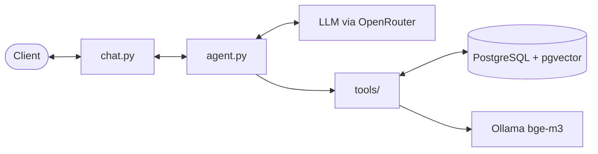

# Laptop Sales Consultant AI Agent

A chat agent for a laptop shop. It answers in Uzbek, Russian and English, recommends laptops from the warehouse,
books them only after the client's explicit "yes", and answers trade-term questions only from the PDF, with
clause numbers. Plain Python, PostgreSQL + pgvector, no agent framework.

## Setup

Needs Docker, Python 3.12+, [Ollama](https://ollama.com) and an [OpenRouter](https://openrouter.ai) API key.

```bash
cp .env.example .env                # fill in the values
docker compose up -d                # PostgreSQL + pgvector
python3 -m venv .venv && source .venv/bin/activate
pip install -r requirements.txt
ollama pull bge-m3                  # embedding model

python scripts/migrate.py           # tables
python scripts/import_warehouse.py  # 511 laptops + shop rules
python scripts/ingest_pdf.py        # 271 PDF clauses with embeddings
```

## Run

```bash
python -m app.chat                    # terminal chat, new conversation
python -m app.chat <conversation_id>  # continue one
python -m streamlit run app/web.py    # web chat on http://localhost:8501
python -m pytest -v                   # tests, on a separate test database
python scripts/run_demo.py            # sample questions -> docs/demo_log.md
```

A demo run (full booking, declined summary, cancellation, sample questions 1-18) is in
[docs/demo_log.md](docs/demo_log.md).

## Architecture



Each turn, **code** first handles a pending "yes"/"no", then the LLM answers with tools, then **code** checks
the answer (cited clauses must be retrieved, booking IDs must come from tools). A failing answer is rewritten once,
then replaced by a safe reply.

## Tools

| Tool | What it does |
|---|---|
| `search_laptops` | In-stock laptops by brand, price, RAM, storage, screen or text; closest alternatives if none match |
| `get_laptop` | Details, price and stock of one offer |
| `compare_laptops` | 2-4 laptops side by side |
| `get_shop_policies` | Shop rules P01-P10 |
| `search_documents` | PDF clauses; nothing below similarity 0.62 |
| `prepare_booking`, `prepare_change`, `prepare_cancellation` | Check the request and save a summary; change nothing |
| `get_booking` | Booking status by ID and phone |

The LLM has no tool that books. Code runs the saved action only on an explicit "yes", with the laptop row locked
(`SELECT ... FOR UPDATE`), in one transaction.

## LLM

**`qwen/qwen3.8-27b`**: open weights (Apache 2.0), 27B parameters. It had the best agentic/tool-use scores among
open models under 200B (Artificial Analysis Agentic Index 46.5%, November 2026), and it was best in our test of
9 open models on the sample questions: 27/27 clean answers, 7.2 s average. Embeddings: `bge-m3`, local.
Model and endpoint are set in `.env`.

## Known limitations

- Chat text, including name and phone, goes to OpenRouter.
- Uzbek answers sometimes contain odd words; replies take 2-7 s, up to 40 s with several tools.
- Only a fixed list of plain answers counts as "yes" ("ha, lekin..." does not).
- The citation check compares clause numbers, not document titles.
- Product facts must come from tools in the same turn: enforced by the prompt, not by code.
- Expired holds are closed at the next booking operation, not by a timer (stock is freed at once).
- Some warehouse rows look wrong and are kept as given (e.g. SO29362480 at 3,850,000 UZS); the agent advises
  checking such prices with the shop.
- The PDF is Uzum Market's; it has no details about our own company (tax ID, address).
